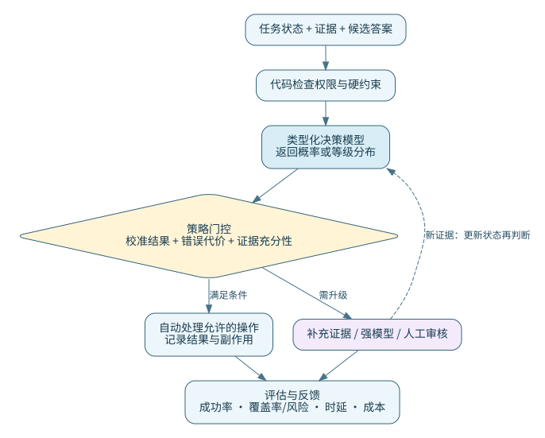

# Jev 决策模型学习记录：原理、概率校准与工程实践

整理日期：2026-10-16。主题：类型化决策、System One、概率校准、智能体路由与安全护栏。

> 资料说明：本文基于用户提供的《Jev 技术分享与应用调研》PDF（20 页，分享日期 2026-10-15）整理。原文件是会议语音转写稿，并非包含完整实验、参考文献和方法定义的学术论文。本文保留技术主线，修正转写和概念错误，补充可核验资料与实践方法；不把讨论中的推测写成已证实的产品实现。
>
> 阅读标记：**原文概括**表示对分享内容的归纳；**核查纠正**表示有源码、文档或数学定义支持的修订；**补充理解**表示推导与工程建议；**待核实**表示缺少充分的一手证据。正文中的 [P] 指原 PDF，数字引用对应文末来源。公开记录只包含整理后的技术内容。

## 1. 先建立整体认识

**原文概括**：许多智能体任务真正需要的只是“选哪个工具”“是否有风险”“优先级多高”，却使用自回归语言模型生成一段 JSON，再解析出一个决定。Jev 一类模型把任务改写为：给定共享状态 `state` 和若干有明确答案类型的 `questions`，返回候选项概率、判断概率或评分。[P，第 1–5 页，00:00–15:18]

**补充理解**：它适合作为高频、有限答案空间的决策组件。它与生成模型可以协作：前者处理分类、选择、筛选和风险信号；后者负责开放式表达、复杂规划、补充证据与解释。System One / System Two 是工作方式的类比，不能据此判断内部是否具有某种“人类直觉”或推理能力。



判断是否值得使用，可以先问四个问题：

1. 能否描述一个充分的状态，并列出候选答案或评分规则？
2. 决策是否足够频繁，值得优化时延、成本和解析环节？
3. 是否有代表性标注数据，可以验证概率及阈值？
4. 业务能否明确处理证据缺失、答案空间不完整和模型不确定？

只满足前两项，适合做原型；后两项决定能否可靠上线。

## 2. 输入输出：先区分题型，再讨论置信度

以下语义已对照 TypeSafe 官方 Python SDK 的类型定义和官方使用指南。[1][2]

| 题型 | 输入应明确什么 | 输出的主要含义 | 常见误用 |
| --- | --- | --- | --- |
| `Noul` | 一个命题，以及何为真、何为假 | `noul = P(命题为真)`，范围 0–1 | 把 0.04 叫作“只有 4% 置信度”；实际上它强烈偏向“假” |
| `Choice` | 候选标签及其适用条件 | 一个选项、每个选项的 `probabilities`，以及单独的 `confidence` | 把候选分布当成“所有现实答案”的概率，或假定 `confidence` 必然等于最大候选概率 |
| `Score` | 从 0 开始、按顺序排列的等级描述 | 各等级概率，以及等级位置的概率加权期望 `score` | 只保存均值，丢掉分布；把得分大小当置信度 |
| `Box` | 要在图像中定位的对象或区域 | 归一化边界框及可能提供的置信度 | 把一个边界框等同于完整检测、分割或任意视觉推理能力 |

当前 SDK 已包含 `Box`，其具体模型支持范围仍要查看所用模型版本；SDK 中的示例使用 `jev-preview`。不能因为 SDK 有这个类型，就推断所有服务和模型均支持。[1]

### 2.1 Noul 的 0.04 到底表示什么

若问题是“此工具调用是否越权”，返回 0.04，含义是模型给越权命题分配了 4% 概率。按 0.5 阈值作二分类时，其选择为“否”；此时所选答案的概率可以写成 `max(p, 1-p)`，即 0.96。但是否放行必须由错误代价决定，不能自动沿用 0.5。

多个标签可以同时成立时，应使用多个判断或真正的多标签接口，而不是把所有标签塞入一个互斥的 `Choice`。多个 Noul 概率无需加起来等于 1。

### 2.2 Score 为什么会有小数

假设等级为 $r\in\{0,1,2,3\}$，其概率为 $p_r$，则：

$$
\mathbb{E}[R]=\sum_{r=0}^{3}r p_r.
$$

例如分布 `[0.10, 0.20, 0.05, 0.65]` 对应期望 2.25。它不是模型又生成了一个“2.25 档”。

**核查纠正**：转写稿先列出 0–3 档，随后出现“3.37 分”。若档位确实只有 0–3，期望不可能超过 3；可能是转写数字有误或漏记了更高档位，不能照抄这个例子。[P，第 3 页，06:13–08:05]

均值相同也可能代表完全不同的判断：在 0–4 档中，全部概率放在 2，与一半放在 0、一半放在 4，期望都为 2。处理争议或风险时应保留完整分布。

官方指南还指出，Choice/Score 的 `confidence` 总结的是分布集中程度，不是整个工作流成功的概率，更不是执行权限。[2] 应分别记录题型、原始分布、返回的置信度和自己定义的门控分数，避免混用。

## 3. 相比文本生成，真正节省了什么

自回归生成通常需要输入预填充，再逐 token 解码；决策模型可以直接读取选项分数，减少生成、协议包装和解析。多个独立问题共享状态时，还可能复用状态计算并批量输出。[P，第 3–4 页；2、6、7]

**核查纠正**：

- **“只输出一个 token”不是所有实现的准确描述。** 有些方法读取一个位置的候选 token logits，有些使用分类头、指针头或向量相似度，根本不采样答案 token。API 返回的 JSON 字节和用量中的 `output_tokens` 也不等于自回归解码步数。
- **“一个前向过程”不意味着常数成本。** 输入长度、候选数量、问题数量、图像、注意力和打分头仍消耗计算与显存。增加问题并非免费。
- **输入共享不必然等于状态只算一次。** 要看注意力结构、缓存实现、批处理方式以及是否真的提供了共享前缀计算。
- **生成模型也能使用结构化输出、约束解码、批处理和前缀缓存。** 因此不能用冗长、无约束 JSON 作为唯一基线，宣布所有收益都来自模型架构。
- **结构合法不等于语义正确。** 请求校验、服务错误、超时和业务规则依然存在；有限选项只能限制答案空间，不能保证选项选对。

分享中的“每百万输入 token 0.042 美元”应视作当时的价格口径，不作为本文核验后的现价。官方 SDK 当前注明输出 token 免费，但具体单价、模型、计费输入和缓存政策必须按实际服务报价核对。[P，第 4 页，10:41；1]

一个更完整的成本估计为：

$$
C_{\mathrm{total}}=C_{\mathrm{decision}}+\rho C_{\mathrm{fallback}}+C_{\mathrm{state}}+C_{\mathrm{retry}}+C_{\mathrm{operations}},
$$

其中 $\rho$ 是升级到强模型或人工的比例。还要测量端到端 p50/p95、吞吐、缓存命中率和最终任务成功率，而不是只比较 GPU 前向时间。

## 4. 概率、准确率与校准：三个概念不要混在一起

设多分类输出为 $p_k(x)$，所选类别为 $\hat y=\arg\max_k p_k(x)$，门控分数暂定义为 $q=\max_k p_k(x)$。这里的 $q$ 是本文的定义，不假定与某厂商的 `confidence` 字段一致。

- **准确率**：最终选对了多少。
- **区分能力**：能否把不同类别或不同难度区分开。需要查看任务指标、排序指标和错误分布。
- **校准**：报出某个概率的一组预测，其事件发生频率是否与该概率一致。

以“所选类别是否正确”为事件，理想的 top-label 校准可以写为：

$$
P(Y=\hat Y\mid Q=q)=q.
$$

有限样本只能按区间估计，不能从单次回答断言“这个样本恰有 80% 正确率”。总是报总体正确率的模型也可能校准得不错，却不能有效识别哪些样本容易出错。高准确率、低 ECE 和高业务价值并不互相等价。

### 4.1 ECE：每个区间比较平均置信度与实际正确率

把样本按 $q_i$ 划分为 $M$ 个桶 $B_m$，常见 ECE 定义为：

$$
\mathrm{ECE}=\sum_{m=1}^{M}\frac{|B_m|}{n}\left|\mathrm{acc}(B_m)-\mathrm{conf}(B_m)\right|,
$$

其中 `acc` 是桶内实际正确比例，`conf` 是桶内预测置信度的平均值。

**核查纠正**：0–0.1 桶应比较“实际正确率”和“桶内平均置信度”，不是要求正确率恰为 10%，也不是直接拿桶中点 5% 代替样本均值。[P，第 6 页，18:16–19:51]

ECE 的局限包括：依赖分桶数量和方式、样本少时不稳定、可能掩盖类别或子群体差异，并且不是严格适当评分规则。常规硬分桶不适合直接作普通反向传播损失，但“不能用于任何训练”说得过于绝对：可以研究平滑近似，强化学习也并不要求奖励对模型参数可微。

### 4.2 Brier：完整类别分布与所选答案正确性是两种不同任务

对二元事件 $y_i\in\{0,1\}$，预测其发生概率为 $p_i$：

$$
\mathrm{BS}_{\mathrm{binary}}=\frac{1}{n}\sum_i(p_i-y_i)^2.
$$

若 $c_i=\mathbf{1}[\hat y_i=y_i]$ 表示“答案是否正确”，而 $q_i$ 是对正确性的预测，则对应的是：

$$
\mathrm{BS}_{\mathrm{correctness}}=\frac{1}{n}\sum_i(q_i-c_i)^2.
$$

它们外形相同，但事件不同。对完整的 $K$ 类分布，本文采用不除以类别数的定义：

$$
\mathrm{BS}_{\mathrm{multi}}=\frac{1}{n}\sum_i\sum_{k=1}^{K}\left(p_{ik}-\mathbf{1}[y_i=k]\right)^2.
$$

这一多分类定义的范围是 0–2；二分类时它等于相应二元 Brier 的两倍。不同库可能使用不同归一化，横向比较前应核对定义。

**补充理解**：只优化 top-label 的正确性分数，不能等同于校准完整类别分布。Brier 与负对数似然是严格适当评分规则，但它们同时受校准、区分能力和数据本身不确定性影响；Brier 下降不必然表示校准单独改善。[4][5]

### 4.3 温度缩放可以用带标签数据拟合，并非只能“盲调”

给定 logits $z_k$ 和正温度 $T$：

$$
p_k(T)=\frac{\exp(z_k/T)}{\sum_j\exp(z_j/T)},\qquad T>0.
$$

常见方法是在独立校准集上最小化负对数似然：

$$
T^*=\arg\min_{T>0}\left[-\sum_i\log p_{i,y_i}(T)\right].
$$

**核查纠正**：温度能通过真实标签拟合，不是只能盲调。一般而言，`T > 1` 使分布变平，`T < 1` 使其更尖锐。单一正温度不改变单个样本的类别 argmax，因此不会修复分类错误，也无法解决证据缺失或复杂的类间偏差。它不保证任何新分布上仍然校准。[P，第 6 页，20:42；4、5]

数据应分为训练集、校准集和最终测试集；时间、用户、会话或来源有关联时应按组切分。不能在测试集拟合温度后再把该测试结果称为独立评估。

### 4.4 RLCR 和 Jev 的 RLCD：明确已知与未知

**已核实**：分享提到的 RLCR 对应 2025 年论文 *Beyond Binary Rewards: Training LMs to Reason about Their Uncertainty*，官方代码在格式正确且成功解析置信度时使用：

$$
r_{\mathrm{Brier}}=1-(c-q)^2.
$$

格式不合格或解析失败的处理、准确率奖励、奖励组合和训练配置，应进一步查看其代码；不能只用这个式子概括全部训练过程。[3]

**待核实**：RLCR 是可参考的公开校准方法，不构成“Jev 的 RLCD 就是照此实现”的证据。本文没有获得 Jev 训练数据、完整奖励、网络结构和消融实验的一手披露，不补写一套声称属于官方的训练配方。交叉熵 SFT 本身也能训练概率分布；是否校准取决于数据、目标、优化与评估，不能简单写成“只有 RLCD 才有概率校准”。

## 5. 六条实现路线：比较计算方式，不把开源方案当作闭源内部实现

### 5.1 SemIf：读取候选 token logits 的低成本基线

转写中的 `sameif` 对应 SemIf（原项目名 OpenJev）。它可以复用冻结模型，从候选编码的 logits 读取决策，避免逐 token 生成答案。当前 README 也已提及按工作负载做温度校准，因此“完全没有任何校准”不应作为永久结论。[6]

若候选编码的 token logits 为 $z_{t_k}$，在候选集合内部归一化可得：

$$
\tilde p_k=\frac{\exp(z_{t_k})}{\sum_{j\in\mathcal A}\exp(z_{t_j})}.
$$

应核实编码在所用分词器和具体上下文中是否真为单 token；“大写英文字母一定是一个 token”不能跨模型、空格和模板无条件成立。重新归一化会丢掉候选集合以外的概率质量，且模型偏好、模板、选项顺序和措辞均可能影响结果。这个分布不自动等于答案正确的概率。

### 5.2 CLM：双编码器与对比学习

CLM 的原项目为 `Contrastive-LM/CLM`，不要把缩写中的 C 与 causal 混淆。其公开说明使用状态和动作编码路径：冻结语言模型主干，加可训练投影头，再通过相似度进行选择。当前说明使用 Qwen3-8B pooling 服务；训练阶段包括配对预训练、困难负例和智能体轨迹后训练。[7]

设 $s_i=f(x_i)$、$a_i=g(o_i)$，InfoNCE 的一个方向为：

$$
L_{s\to a}=-\frac{1}{B}\sum_i\log\frac{\exp(s_i^\top a_i/\tau)}{\sum_{j=1}^{B}\exp(s_i^\top a_j/\tau)}.
$$

对称目标再加入反向检索。**核查纠正**：分母包含正例和负例；不能把正例仅放在分子、负例仅放在分母。[P，第 7–8 页，24:17–29:09]

独立、固定的动作描述可缓存向量；变化的状态需要重新编码。还应检查重复答案、多个正确动作形成的假负例，以及 softmax 相似度是否在目标任务上校准。**对比训练的温度和事后拟合的校准温度不是同一个概念。**

### 5.3 Kev：可变候选的指针头与问题隔离

转写中的 `cube`、`keep` 等可按上下文对应 Kev。它把状态、问题和选项组织成特殊分隔符序列，以问题末尾 `<decide>` 的隐状态查询各选项 `</opt>` 位置的隐状态，经过指针头和 softmax 得到候选分布。共享打分头可以处理不同数量的候选项，而不是为每个固定类别永久分配一个输出神经元。[8]

**更新补充**：当前 Kev README 明确区分主干：纯注意力模型可通过问题隔离的注意力 mask 和位置编号复用状态；Qwen3.5/3.8 的混合结构还包含 Gated DeltaNet，递归层不会遵循注意力 mask，因此使用独立问题行及状态缓存来实现隔离。最新 27B 版本还使用全参数微调，不能概括为“所有型号都是 LoRA”。

这说明只说“加一个 tree mask 就能隔离所有模型”并不充分；需要检查所有具有状态传播的层。

### 5.4 Laya：双向编码与候选位置打分

Laya 展示了无需沿用自回归解码器的路线。对双向编码器，可把候选项的指定位置表示送入共享打分头。**核查纠正**：BERT/ModernBERT 应称为双向编码器，通常以掩码语言建模等目标预训练，不是“双向自回归模型”。[P，第 9–10 页，32:20–36:08]

当前公开 README 列出了 ModernBERT-large 的 421M 模型和 mmBERT-base 的 322M 多语言模型等，参数量、上下文长度与语言能力必须连同 checkpoint 一起记录。“只有 396M”至多是旧版本或不同统计口径，不能当作整个系列的现状。[9]

转写中“logits 噪声增强”与“高斯噪声”的具体分布、目标和阶段没有附精确实现位置，本文不擅自补成确定公式。应以所用版本的训练脚本为准；噪声增强也不自动保证选项置换不变性。

### 5.5 Clef：联合候选与问题特征的打分设计

转写中的 `cleft`、`cliff` 应规范为 Cloudflare 的 **Clef**。[P，第 10–12 页，36:08–44:58]

**原文概括**：分享描述了一类较复杂的头部：池化问题及候选表示，结合非上下文化的词嵌入，通过交叉注意力从状态检索证据，再融合语义相似度、候选匹配与 MLP 残差得分。它可以作为理解联合打分头的线索。

**待核实**：本次研究环境未能访问 Cloudflare 的模型卡原文，因此不把上述转写重建成“已逐行核验的 Clef 精确架构”，也不确认“10 月 1 日发布”和完整训练配方。正式复现实验应补齐模型版本、代码提交、张量定义和权重许可，再讨论消融与效果。原始入口列在参考资料 [12]。

### 5.6 Vela / vLLM Semantic Router：决策与片段抽取要分开

转写描述了同时支持 `Choice/Noul/Score/Set/Span` 的实现思路：分类头给标签打分，片段头进一步定位原文中的实体或证据。[P，第 12–13 页，44:58–49:20]

**补充理解**：多标签可以用逐标签 sigmoid/Noul 建模，但是否需要标签依赖、互斥约束和结构化后处理，要看任务；不能说所有 `Set` 都只是若干独立判断。Span 抽取还必须定义边界、多个片段、无答案、重叠片段及偏移量，而非只给每个 token 一个相似度就结束。

**版本提醒**：vLLM Semantic Router 官方 README 同时列出了 Vela 2.0、Decision 2.0 和 Decision 3.0 的不同发布记录。转写所说的 Vela 具体 checkpoint、双头结构及其对应代码尚未一一核实，不能把不同系列或新旧版本混为一谈。[10]

### 5.7 路线比较

| 路线 | 主要读出方式 | 可能复用什么 | 重点检查 |
| --- | --- | --- | --- |
| 候选 token logits | 受限 token 集的相对分数 | 语言模型、前缀计算 | 分词、集合外质量、模板偏差、校准 |
| CLM 双编码器 | 状态与动作向量相似度 | 固定候选向量 | 假负例、候选描述变化、目标任务分布 |
| Kev 指针头 | 问题表示与选项表示匹配 | 满足实现条件的状态缓存 | 注意力与递归状态隔离、位置编号 |
| Laya 双向编码 | 候选位置表示的共享打分 | 批处理；是否能共享状态须实测 | 上下文长度、多语言、编码顺序 |
| 联合特征/交叉注意力头 | 证据检索加融合打分 | 视具体实现而定 | 候选交互、计算成本、源码版本 |
| 分类加 Span 头 | 标签概率与边界/片段预测 | 共享主干 | 边界与无答案处理、片段级校准 |

这些项目证明“类型化决策”可以有多种实现，并不能揭示闭源 Jev 的真实内部结构。通用的文本标签分类、自然语言推断和相似度检索也早已存在；新的工程价值应从接口、训练数据、校准、缓存、评估和业务效果共同衡量。

## 6. 并行、隔离、顺序：需要分别测试

“多个答案同时返回”至少可能指一份请求批量处理、一次模型前向，或共享前缀后分支计算。三者不是同义词。

对纯因果注意力模型，希望每个问题只看到状态和自身时，逻辑上可以设计如下可见性：

```text
查询位置       状态 S     问题 Q1    问题 Q2
状态 S         因果       不可见     不可见
问题 Q1        可见       自身因果   不可见
问题 Q2        可见       不可见     自身因果
```

还要处理位置编号、缓存分支和混合模型的递归状态。双向拼接模型中，状态表示可能依赖后面的题目，不能直接套用因果前缀缓存。

**核查纠正**：选项互换后答案变化，不能证明“问题之间没有隔离”。选项顺序敏感是同一题内部的问题；问题隔离应测试“固定 Q2，改变、增删或重排 Q1 后，Q2 是否变化”。即便不存在跨题注意力，位置编码、数值误差和批处理也应检查。[P，第 14–15 页，51:48–56:57]

建议至少做四组配对测试：

1. 只改变选项顺序，映射回原标签后比较概率和选择。
2. 固定某题，改变其他题的内容、数量、顺序和长度。
3. 逐题请求与合并请求比较，同时测结果及实际端到端时延。
4. 保持事实不变，仅更换标签名称、模板或加入无关文本，检查稳健性。

## 7. 用在智能体与安全护栏：把决策分数接到明确策略上

### 7.1 快慢模型协作

一种起点是：独立规则先校验动作合法性；决策模型为明确候选打分；满足经过验证的条件时自动执行；证据不足、超出候选集合或风险较高时补证据、升级强模型或转人工。

`max(p)`、分布熵、首二名差距和模型返回的 `confidence` 是不同信号，应在代表性数据上比较，而非任选一个当“正确率”。加入 `other` 或 `insufficient_evidence` 可以提供出口，但不能替代对分布外输入的测试。

### 7.2 按错误代价设置风险阈值

令 $p=P(\mathrm{unsafe}\mid x)$，误拦安全操作的代价为 $C_{\mathrm{FP}}$，漏放不安全操作的代价为 $C_{\mathrm{FN}}$。若正确决策代价为零，则：

$$
R(\mathrm{allow})=p C_{\mathrm{FN}},\qquad R(\mathrm{block})=(1-p)C_{\mathrm{FP}}.
$$

在这些假设及概率可靠时，选择拦截的阈值为：

$$
p>\frac{C_{\mathrm{FP}}}{C_{\mathrm{FP}}+C_{\mathrm{FN}}}.
$$

例如漏放代价为 100、误拦为 1，阈值约 0.0099，远低于 0.5。真实业务可能有审核、延迟、不同风险等级和非零正确处理成本，应重新定义损失矩阵。

权限、允许的资源、金额或操作范围等硬约束应由代码和授权规则执行；模型分数只提供风险信号。

### 7.3 失败后不能普遍“直接执行第二名”

**核查纠正**：第一名失败通常提供了新信息，甚至已经产生部分副作用。此时需要更新状态，检查失败类别和操作幂等性，再决定是否重试。原排名不必适用于新状态。[P，第 1–2 页，01:48–02:22]

只有在业务预先允许替代、状态未发生实质变化、失败不改变候选成功条件等前提下，预计算排名才能用于低成本回退。决策概率表示什么也要说清：动作是否合适，与动作执行后成功的概率并不天然相同。

### 7.4 多风险信号的组合

危险指令、越权访问、意图偏离等风险可能同时出现，适合保留各自判断。若策略要求“任一严重违规即拦截”，直接对分数做加权平均可能把严重风险抵消掉，应使用明确的规则组合。

状态压缩也会丢失证据。压缩后仍应保留授权边界、来源可信度、最近工具结果、未完成副作用和相关原文定位。低可信数据中的“请忽略规则”等内容是待分析数据，不能升级成分类器或执行器的新指令。

## 8. 如何做可信的评测

### 8.1 数据与基线

- 将训练、校准、验证策略和最终测试的用途分开，记录切分方法。
- 覆盖真实的语言、类别比例、长上下文、候选数量、缺失证据、歧义、多标签和攻击样本；按会话、来源和时间防止泄漏。
- 同一数据上比较规则/轻量分类器、受约束短输出的 LLM、token-logit 基线及决策模型；保持证据、候选定义和成功标准一致。
- 独立记录人工标注、多个标注者的分歧与软标签含义；LLM 生成或裁判的标签不能冒充独立人工真值。

### 8.2 指标应覆盖决策、概率和整个任务

| 维度 | 推荐记录 |
| --- | --- |
| 分类/多标签 | accuracy、macro-F1、各类 precision/recall；少数风险类另报漏放率和误拦率 |
| 概率 | NLL、明确归一化的 Brier、ECE/可靠性图；按类别、语言、长度和来源分组 |
| 有序评分 | MAE、等级混淆矩阵、必要时 QWK；期望和等级分布分开评估 |
| Span/Box | 片段精确匹配/F1、边界偏移或 IoU 等定位指标，以及无答案识别 |
| 升级策略 | 自动处理覆盖率、被自动处理样本的错误率、强模型/人工比例及代价 |
| 系统 | 端到端 p50/p95、吞吐、输入长度、显存、缓存命中、重试及最终任务成功率 |

阈值 $\theta$ 对应的自动处理集合为 $A_\theta$，可报告：

$$
\mathrm{coverage}(\theta)=\frac{|A_\theta|}{n},\qquad
\mathrm{risk}(\theta)=\frac{\sum_{i\in A_\theta}\mathbf{1}[\hat y_i\ne y_i]}{|A_\theta|}.
$$

集合为空时 risk 未定义，不能记成“零风险”。选择阈值后，要在独立测试集报告区间及样本数；不能只挑一个好看的阈值或分组平均数。

**核查纠正**：某个实验里较低升级阈值获得更高任务成功率，不足以推出“决策模型在简单任务上普遍更准”。还需看模型、数据、样本量、阈值选择和误差范围。[P，第 17 页，01:02:51]

即便每步决策很准，多步任务仍可能积累错误。例如仅在独立且每步成功率都为 0.99 的理想假设下，100 步全成功的概率约为 $0.99^{100}\approx0.366$；真实智能体通常还存在相关错误、恢复机制和状态漂移，必须测端到端结果。

### 8.3 有序 Score 可以补充顺序敏感损失

普通交叉熵不显式表达“错一档比错四档轻”。一种补充是对累计分布施加平方距离：

$$
L_{\mathrm{ordinal}}=\sum_{r=0}^{K-2}\left(F_p(r)-F_y(r)\right)^2,
$$

其中 $F_p$ 是预测等级累计分布，$F_y$ 是真实等级的累计分布。这是可选择的建模方案，不是对 Jev 或任何未核实训练配方的断言。

把“确定黑、倾向黑、倾向白、确定白”直接映射为若干数值再做 MSE，也不自动完成概率校准：必须解释数值是事件频率、标注分歧还是主观严重程度，并在独立数据上验证。

## 9. 可运行练习：先亲手算出校准指标

仓库附带一个**无第三方依赖、无 API 调用**的演示：

```bash
python3 learning-notes/examples/jev_calibration_demo.py
python3 learning-notes/examples/jev_calibration_demo.py --self-test
```

[查看校准演示源码](examples/jev_calibration_demo.py)。它实现稳定 softmax、NLL、完整多分类 Brier、top-label ECE、覆盖率/风险，并只在合成校准集上搜索温度，最后在独立合成测试集上报告结果。示例用于理解公式与数据切分，**不是 Jev、Kev 或其他真实模型的性能测试**。

本次运行使用 500 条合成校准样本、1000 条独立合成测试样本，固定随机种子，网格搜索得到温度约 2.9282。测试输出为：

| 指标（合成测试集） | 原始概率 | 温度缩放后 |
| --- | --- | --- |
| 准确率 | 0.718 | 0.718 |
| NLL | 0.776865 | 0.559623 |
| 多分类 Brier（类别求和） | 0.428360 | 0.375352 |
| top-label ECE（10 桶） | 0.164349 | 0.028310 |

这只展示本次合成实验；真实任务或分布漂移后不保证出现同样改善。

学习时观察：

1. 正温度缩放后，逐样本 argmax 保持不变；准确率可以不变而 NLL/ECE 改变。
2. Brier 的二分类与完整两类形式有两倍系数差异。
3. 提高置信门槛通常降低覆盖率，但风险是否下降需要数据证实。
4. 所有预测被拒绝时，风险输出为 `null`，不伪装成 0。

### 官方 SDK 的最小接口示例

以下用法对照官方 SDK 源码编写，**本次没有实际调用收费 API**，也未进行模型效果测评。[1]

```python
from typesafe_sdk import Choice, Noul, Score, TypeSafeClient

with TypeSafeClient() as client:  # 在运行环境中安全配置 TYPESAFE_API_KEY
    result = client.system_one(
        model="jev-latest",  # 做可复现实验时应固定实际模型版本
        state={"ticket": "订单被重复扣款，请核查。"},
        questions={
            "category": Choice(
                instructions="请选择最合适的工单类别。",
                criteria={"billing": "账单或扣款", "technical": "技术故障", "other": "其余情况"},
            ),
            "sensitive": Noul(instructions="工单是否包含密码或完整支付卡号？"),
            "urgency": Score(criteria=["可排队处理", "今天应处理", "需要立即处理"]),
        },
    )

print(result.choices["category"].probabilities)
print(result.nouls["sensitive"].noul)   # 是“命题为真”的概率
print(result.scores["urgency"].score)  # 等级期望，不是概率
```

不同厂商的类似接口不必使用相同字段或题型命名。例如 OpenAI 官方 Python SDK 当前确有 `Decisions` 资源，源码说明支持 `gpt-6-luna`，题型文档用 predicate、choice、score。不能只把 TypeSafe 请求地址替换过去就假定兼容；分享中的具体发布日期仍需官方发布记录确认。[11]

## 10. 原稿纠错与待核实事项索引

| 定位 | 原稿表述/线索 | 本记录的处理 |
| --- | --- | --- |
| 第 2–3 页，03:24–08:05 | `nor/no尔`、打分、3.37 | 规范为 `Noul`；区分真概率和等级期望；指出 0–3 档不可能得到 3.37 |
| 第 3–4 页，08:05–11:20 | 每问一个 token，问题/选项数量不影响求值 | 区分读出方式、解码步数与总计算量；额外问题仍有成本 |
| 第 4 页，10:41 | 固定单价、输出免费 | 单价保留为未核实历史口径；输出免费仅按当前官方 SDK 的说明记录 |
| 第 5 页，15:18–17:21 | RLCD 可能参考 RLCR | 找到 RLCR 原论文与奖励源码，但不据此断言闭源方法的来历 |
| 第 6 页，18:16–20:42 | ECE 桶端点；温度只能盲调 | 应比较桶内均值；温度可在校准集最小化 NLL |
| 第 6–7 页，22:20–24:17 | `sameif`；字母一定为单 token | 规范为 SemIf；分词必须实测，候选归一化不自动校准 |
| 第 7–8 页，24:17–29:09 | `CRM`；InfoNCE 分母描述 | 规范为 CLM；分母包含正例与负例；当前主干冻结、训练投影头 |
| 第 8–9 页，29:09–32:20 | `cube/keep` | 对应 Kev；补充不同主干下的问题隔离与缓存条件 |
| 第 9–10 页，32:20–36:08 | 双向自回归、396M、噪声分布 | 修正编码器术语；当前参数需按 checkpoint；噪声细节不臆补 |
| 第 10–13 页，36:08–49:20 | `cleft/cliff`、Vela 精确架构 | 规范名称；标记模型卡与代码未逐项核验的部分 |
| 第 14–15 页，54:27–56:57 | 选项重排变化意味着问题未隔离 | 区分选项顺序敏感与跨题信息泄漏，用不同实验检验 |
| 第 16–17 页，01:00:00–01:05:19 | 有序分数、低阈值更好、软标签校准 | 补充有序损失、独立测试及软标签的语义前提 |
| 第 18–20 页，01:08:53 以后 | Jevons 悖论、估值、市场因果 | 杰文斯效应是需求扩张可能抵消效率收益的经济机制，并非必然规律；未核实估值和股价归因不作技术结论 |

## 11. 我的后续学习路线

- [ ] 跑通附带的校准演示，能解释各个指标的事件、范围和归一化。
- [ ] 为一个真实任务写清 `state`、候选定义、无答案出口与错误代价。
- [ ] 在相同数据与硬件口径下比较规则、受约束 LLM 和一种开源决策模型。
- [ ] 做选项重排、跨题隔离、长上下文和证据缺失测试，保存原始概率。
- [ ] 在独立校准集拟合温度，选策略阈值，再一次性读取最终测试结果。
- [ ] 用最终任务成功率、覆盖率/风险和真实账单判断是否值得接入。
- [ ] 补齐 Clef 原始模型卡、Vela 对应 checkpoint 及 Jev 官方方法披露后，再更新架构结论。

## 12. 参考资料与证据边界

访问及整理日期：2026-10-16。以下项目说明代表对应版本作者的公开信息，作者自报性能不等于本文复现实验；本记录没有训练或评测真实决策模型。动态主分支内容可能更新，关键实现优先给出提交固定的链接。

- **[P] 用户提供的 PDF**：《Jev 技术分享与应用调研》，20 页会议转写，分享日期 2026-10-15。定位使用 PDF 页码与发言时间；未附完整原始幻灯片和一手参考文献。
- **[1] TypeSafe 官方 Python SDK**：[question_types.py](https://github.com/typesafe-ai/typesafe-sdk-python/blob/f36e68549ceca3191e5791e5f99ea1baa1a258b5/src/typesafe_sdk/_core/question_types.py)、[API 数据模型](https://github.com/typesafe-ai/typesafe-sdk-python/blob/f36e68549ceca3191e5791e5f99ea1baa1a258b5/src/typesafe_sdk/_schemas/models.py)。用于核验题型、字段、期望得分、Box 与用量语义。
- **[2] TypeSafe 官方使用指南**：[skills/typesafe-ai/SKILL.md](https://github.com/typesafe-ai/skills/blob/65a39f393687675ce170e6094757de20370365b9/skills/typesafe-ai/SKILL.md)。这里作为研究资料引用；重点是并行独立问题、分布集中程度、目标域评估与策略组合。
- **[3] Damani 等，2025**：*Beyond Binary Rewards: Training LMs to Reason about Their Uncertainty*，[论文 arXiv:2507.16806](https://arxiv.org/abs/2507.16806)、[官方代码与说明](https://github.com/damanimehul/RLCR/tree/be2624b1753d738b9552df4dd6d50ac33b3668ee)、[奖励函数](https://github.com/damanimehul/RLCR/blob/be2624b1753d738b9552df4dd6d50ac33b3668ee/reward_fns.py)。本次直接核验的是官方 README 和奖励代码。
- **[4] Guo、Pleiss、Sun、Weinberger，2017**：*On Calibration of Modern Neural Networks*，[论文 arXiv:1706.04599](https://arxiv.org/abs/1706.04599)、[作者提供的温度缩放说明](https://github.com/gpleiss/temperature_scaling)。旧代码已停止维护，本文不建议直接照搬其旧环境。
- **[5] scikit-learn 校准文档**：[文档源码](https://github.com/scikit-learn/scikit-learn/blob/main/doc/modules/calibration.rst)。用于核对温度拟合、独立校准数据和 Brier 分解的限制。
- **[6] SemIf**：[项目 README](https://github.com/TheoLeeCJ/SemIf-OpenJev/blob/23cf1f39fc9534fe81437200959b6dfc7106e45a/README.md)。原项目路径可能重定向至新名称；参考其 frozen-model 读出方式与校准更新。
- **[7] Contrastive-LM / CLM**：[架构与训练说明](https://github.com/Contrastive-LM/CLM/blob/d5f9ef0fd9bde185df0ceaad4f4ecc6cfe8c34f6/README.md)。包括冻结主干、投影头、双向 InfoNCE 和困难负例。
- **[8] Jared Palmer / Kev**：[固定版本 README](https://github.com/jaredpalmer/kev/blob/1f04cfa28e6a708485b28a9585010b9e436b776e/README.md)。用于核验指针头、不同主干的隔离、缓存与温度校准。
- **[9] Laya**：[固定版本 README](https://github.com/NandhaKishorM/laya/blob/4ac226d5ee88ed6df8db288a05c766d7a34ee682/README.md)。使用其模型家族与 checkpoint 信息，未把自报毫秒数作为本次测量。
- **[10] vLLM Semantic Router**：[官方 README](https://github.com/vllm-project/semantic-router)。用于区分 Vela 与 Decision 系列发布记录；不作为转写中某个 Span head 的精确结构证明。
- **[11] OpenAI 官方 Python SDK**：[Decisions 资源实现](https://github.com/openai/openai-python/blob/230a923faba5574ebdc5b45a505a26b6bad79f61/src/openai/resources/decisions.py)。核验接口存在、题型描述与当前模型限制，不用于证明具体发布日。
- **[12] Clef 原始资料入口（待直接核验）**：[Cloudflare 模型卡](https://huggingface.co/Cloudflare/clef)、[官方介绍](https://blog.cloudflare.com/clef-decision-models)。本次网络未能访问原文；只保留可追溯入口，不据此引用未读的实验数值或精确实现。

学习记录的核心收获：把概率的事件、答案空间、校准数据和执行策略定义清楚，再讨论模型速度与成本；对闭源细节、转写错误和版本差异，保留证据边界。
