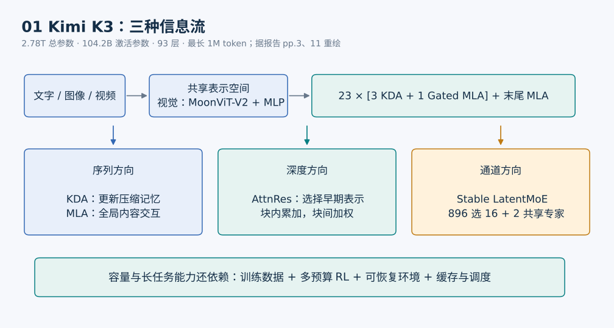
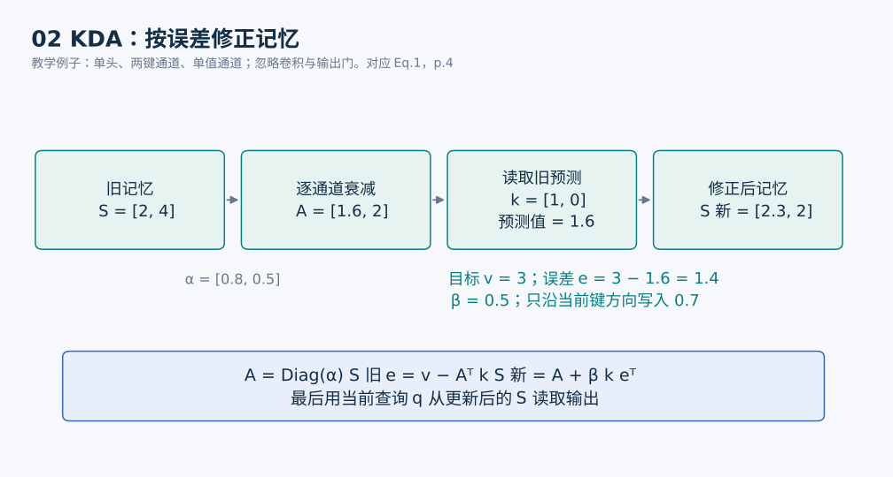
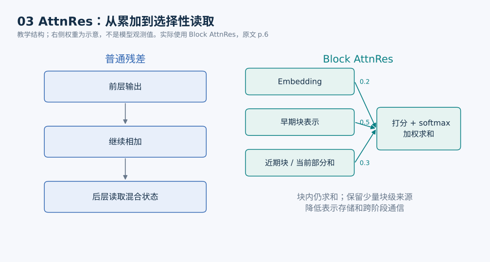
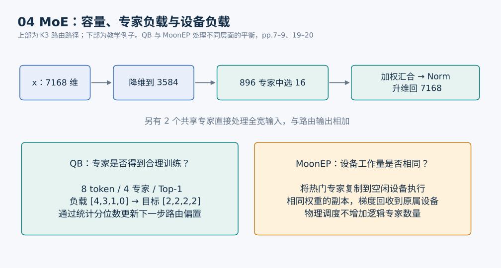
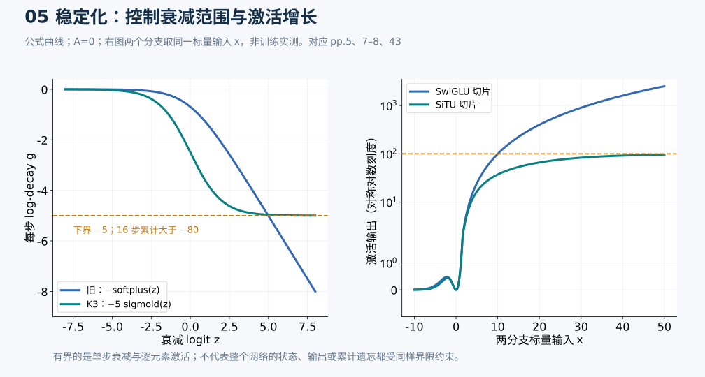
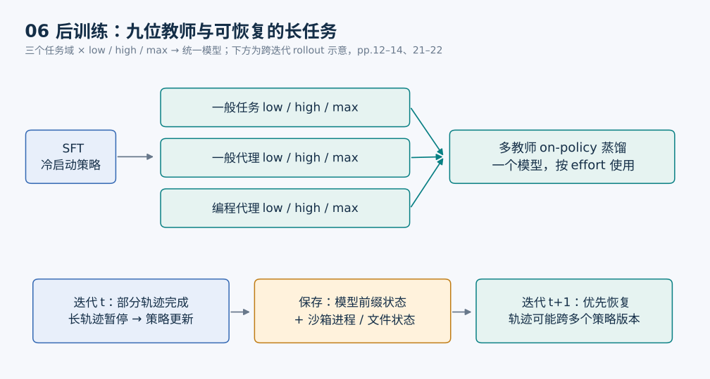
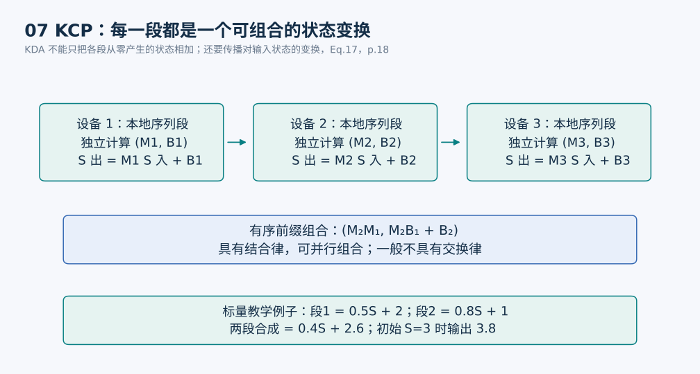
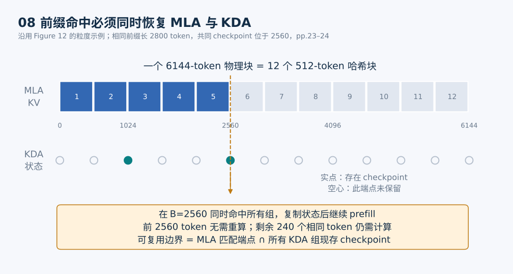
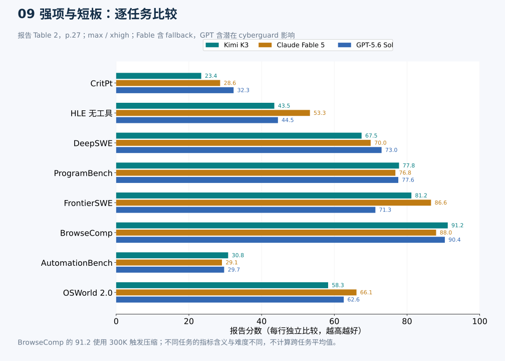
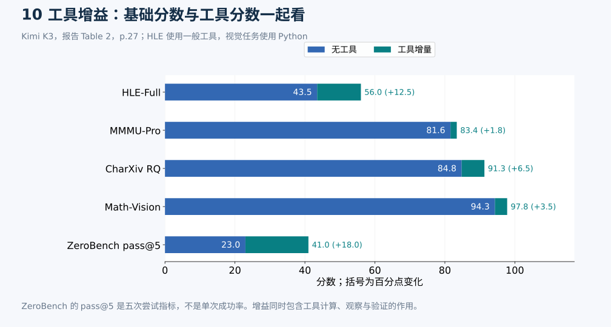

# Kimi K3 技术报告详解

Kimi K3 最值得理解的，是它如何把更大的模型、百万 token 上下文和长时间执行任务连接成一套可运行的系统。报告提出的核心组合是：**KDA 负责高效处理序列，AttnRes 负责跨层取用信息，Stable LatentMoE 负责扩大稀疏容量，强化学习负责把这些能力转化为持续行动和验证。** 与之配套的训练、缓存和调度系统，使这些设计能在有限显存和计算预算下运转。

本文以 47 页《Kimi K3: Open Frontier Intelligence》为主要依据。页码采用 PDF 页面下方的编号，与本文件的物理页序一致。图示均为重新绘制的解释图；其中的玩具数字会注明，评测图使用报告中的原始数值。**“报告结果”表示作者报告的证据，“解读”表示对机制的解释或推论。** 榜单、成本数据保留原报告的时间口径，不作为实时排名或报价。

- [官方报告 PDF](https://github.com/MoonshotAI/Kimi-K3/blob/main/k3_tech_report.pdf)
- [官方项目](https://github.com/MoonshotAI/Kimi-K3) · [模型权重与模型卡](https://huggingface.co/moonshotai/Kimi-K3)
- [图示和生成脚本](kimi-k3/README.md) · [评测数据 CSV](kimi-k3/benchmark-data.csv)

## 一 阅读路线与主要结论

如果只读一遍，建议沿着以下问题阅读：模型如何“记住”前文，如何“挑选”前层表示，如何“调用”专家，如何“学会”长任务，最后如何验证效果。架构部分需要一点线性代数；后半部分侧重系统和实验解释。

| 想理解的问题 | 对应章节 | 原文位置 |
| --- | --- | --- |
| 2.8T 参数为什么每个 token 只激活约 104B | 二、六 | §2.3，pp.6–9；Table 1，p.11 |
| 百万上下文为何还需要全局注意力 | 三、四、八 | §2.1，pp.4–6；§3.4，p.12 |
| AttnRes 如何改变残差连接 | 五 | §2.2，p.6 |
| 训练为什么要同时改激活函数和路由 | 六、七 | §2.3，pp.6–9；附录 B–D，pp.43–45 |
| 模型怎么学会长期使用工具 | 九、十 | §4，pp.12–16 |
| 长任务为什么需要缓存和可恢复沙箱 | 十一至十三 | §5，pp.17–25 |
| 哪些结果强，哪些结果仍有差距 | 十四至十六 | §6–7，pp.25–34 |

**报告支持的主要结论**：K3 在报告所选的编程、搜索、工具使用和视觉任务上表现接近其比较对象中的最强闭源系统，部分项目领先；研究级推理、部分计算机操作和代理行为质量仍有差距。它并非每个任务都最强。报告关于约 2.5 倍 scaling efficiency 的结论来自整套架构、数据和训练配方的缩放实验，不能单独归功于一个模块。

*图1：输入文字和视觉表示进入同一个骨干。序列、深度、通道三个方向分别对应混合注意力、AttnRes、Stable LatentMoE。示意综合原文 Figure 2、Table 1，pp.3、11。*

## 二 参数表应该怎样读

| 项目 | Kimi K2 | Kimi K3 | 含义 |
| --- | ---: | ---: | --- |
| 总参数 | 1.04T | 2.78T | 所有权重的总规模 |
| 激活参数 | 32.6B | 104.2B | 一个 token 所经过的活跃计算路径规模 |
| 骨干层数 | 61 | 93 | 更深的计算网络 |
| 隐藏维度 | 7168 | 7168 | 主干宽度保持不变 |
| 路由专家数 | 384 | 896 | 可供选择的专家池 |
| 每 token 激活路由专家 | 8 | 16 | 每次实际调用的专业分支 |
| 共享专家 | 1 | 2 | 每个 MoE 层保留的公共分支 |
| 路由专家潜在维度 | 无 | 3584 | 专家路径只接收主干一半宽度 |
| 注意力组成 | 61 MLA | 69 KDA + 24 MLA | 局部递归记忆与全局内容交互结合 |
| 最大训练上下文 | 128K | 1M | 经分阶段扩展获得 |

*来源：原文 Table 1，p.11。摘要中的 2.8T、104B 是四舍五入后的表述。*

可以把 MoE 想成一家有 896 个专业小组的机构。处理一个 token 时，路由器选择 16 个小组，并保留两个共享分支处理通用变换。**这些“专家”是神经网络中的前馈子网络，不能理解为 896 个有独立对话和记忆的智能体，也不能保证每个专家都有清晰的人类学科标签。**

有两个容易混淆的比例：

- 路由稀疏度为 `896 / 16 = 56`，即每个 token 使用约 1.79% 的路由专家。
- 激活参数占总参数约 `104.2 / 2780 = 3.75%`。这个比例还涉及注意力、共享分支等，不能用 16/896 直接替代。

稀疏激活降低了每个 token 的计算量，但整个模型的权重仍需被存储、分片或按需搬运。按“所有权重都是 4 bit”的理想化算术估算，2.78T 参数仅权重就约需 **1.39 TB，约 1.26 TiB**；报告实际还有高精度组件、量化元数据、缓存和运行时内存。因此，104B 激活参数并不意味着模型能按一个普通 104B 稠密模型的完整存储成本部署。这个估算是容量直觉，不是实测部署配置。

## 三 KDA 如何把前文变成可更新的记忆

### 传统注意力与递归状态

全局注意力允许当前 token 直接比较历史 token 的键，再读取相应的值。它像可以逐条查询的档案库；随着历史变长，需要保留更多 KV 信息。在常规实现和固定维度条件下，完整序列的注意力交互随长度呈二次增长，单步解码访问历史的代价也随历史长度增加。

KDA 维护的是一个固定形状的矩阵状态 `S`。它像不断更新的关联记忆表：读到一个 token，就修改记忆；查询时，从这张表读出结果。它避免为每层 KDA 保存所有历史 token 的完整 KV，但压缩表示会带来信息竞争，不能承诺无损保留任意长历史。

对单个注意力头，设 `k_t, q_t` 是键和查询，`v_t` 是值，`α_t` 是逐通道保留系数，`β_t` 是写入强度。报告的核心递推为：

$$
S_t=(I-\beta_t k_t k_t^\top)\operatorname{Diag}(\alpha_t)S_{t-1}+\beta_t k_t v_t^\top
$$

$$
\widetilde{o}_t=S_t^\top q_t
$$

*来源：§2.1.1，Eq.1，p.4。`S` 的形状是键维度乘值维度。*

### 用三步拆开公式

定义衰减后的记忆 `A_t = Diag(α_t) S_(t−1)`，上式可以等价改写为：

$$
\widehat{v}_t=A_t^\top k_t,\qquad e_t=v_t-\widehat{v}_t,\qquad S_t=A_t+\beta_t k_t e_t^\top
$$

1. **先遗忘**：不同键通道乘上不同的 `α`，决定哪些记忆保留得久，哪些衰减得快。
2. **再检查**：用当前键读取旧记忆，得到它现在“认为应该对应”的值。
3. **按误差写入**：把新值与旧预测的差异写回去，而非不断叠加所有新值。

“delta”可以理解为按预测误差修正。`β` 控制修改幅度，`α` 控制记忆寿命，两个门承担不同职责。

*图2：玩具例子，状态是两行一列，忽略多头和输出门。旧状态 `[2,4]` 经 `[0.8,0.5]` 衰减成为 `[1.6,2]`；当前键为 `[1,0]`，目标值为 3，写入强度为 0.5，更新后状态为 `[2.3,2]`。这不是报告中的实测状态。*

实际 KDA 还包含短卷积、Swish、Q/K 的 L2 归一化、按头 RMSNorm 和输出门。短卷积帮助局部混合，归一化控制数值尺度；输入相关的全秩输出门决定记忆读出的哪些通道继续向后传递。不能把核心递推式当成完整实现。（§2.1.1，pp.4–5）

### 递归并不等于训练时逐 token 串行

报告采用“块间递归、块内并行”的计算形式。一个 chunk 的输出包含两部分：前面 chunk 传来的状态，以及当前 chunk 内 token 之间的因果交互。后者可以改写为矩阵运算，使用 GPU Tensor Core。因果掩码保留对角线，因为一个位置读取的是当前 token 已写入后的状态。（Eq.3–4，p.4）

真正的工程问题是：数学等价的写法，可能在有限精度下表现很不一样。

## 四 为什么修改遗忘门就能改变 GPU 性能

KDA 的块内计算需要使用累计保留系数的倒数。如果保留系数连续很小，它们的乘积会非常接近零，倒数就可能溢出。

此前 Kimi Linear 使用的每步 log-decay 没有有限下界。K3 改为：

$$
g_t=g_{\min}\operatorname{Sigmoid}(e^A z_t),\qquad g_{\min}=-5,\qquad \alpha_t=e^{g_t}
$$

由此每个通道满足 `−5 < g < 0`，也就是 `exp(−5) < α < 1`。在 16-token tile 内，累计 log-decay 位于 `−80` 到 `0` 之间，倒数缩放小于 `exp(80)`，仍在 BF16 的动态范围内。（§2.1.1，Eq.5，Figure 3，p.5）

**解读**：这相当于给记忆衰减装上数值范围明确的阀门。修改的直接收益，是原来需要专门逐位置对处理的对角 tile，也能走密集 Tensor Core 矩阵乘路径。模型参数化和硬件计算方式在这里相互约束。

这不表示模型“最多只能忘记到某个累计程度”：下界限制的是**单步**衰减，跨很长序列的累计衰减仍可极强。它也不意味着所有数值误差消失，更不能把局部 kernel 收益等同于端到端训练提速。

### 为什么保留 Gated MLA

K3 的骨干按三个 KDA 层、一个 Gated MLA 层的模式重复，末尾再加一个 MLA。因此 93 层为：

`23 × (3 KDA + 1 MLA) + 1 MLA = 69 KDA + 24 MLA`。

MLA 把每个 token 的 KV 表示压缩成低维潜变量，再用于全局内容交互。它提供对历史内容的直接访问；KDA 提供更便宜的顺序混合。**K3 整体仍有随序列长度增长的 MLA KV cache，不能称为整个模型“常数缓存”或所有计算都严格线性。**（§2.1.2，pp.5–6；Table 1，p.11）

MLA 使用 NoPE，没有显式位置编码；KDA 的顺序递推和衰减提供位置敏感信息。NoPE 避免了扩窗时重新调整 RoPE 的步骤，但不自动赋予百万上下文能力。后续数据和训练课程仍然必要。

## 五 AttnRes 如何让深层网络重新选择信息

普通残差连接可以写成 `h_(l+1) = h_l + f_l(h_l)`。它对优化很有帮助，但前面不同层的输出逐渐混在同一个累积状态里。深层模块要提取某一层的信息，往往需要从混合表示中恢复它。

AttnRes 把“到历史 token 中检索”的思想移到深度方向：一个模块可对前面的表示分配权重，再形成输入。可以把普通残差理解为把前面所有会议纪要写在同一页，AttnRes 则允许当前环节给几份阶段纪要分别打权重。

$$
a_{i\to l}=\operatorname{softmax}_i(w_l^\top\operatorname{RMSNorm}(b_i)),\qquad h_l=\sum_i a_{i\to l}b_i
$$

这里用 `b_i` 表示可供读取的来源。`w_l` 是该层学习到的 pseudo-query；虽然它并非由当前 token 生成的 Q 投影，权重仍会随各来源的 token 表示变化。RMSNorm 用于打分，避免幅度较大的来源仅因数值尺度而占优；值表示本身按报告定义聚合。（§2.2，Eq.8–10，p.6）

*图3：权重数字仅用于解释选择性读取。实际使用 Block AttnRes，块内仍累加，块间才保留可单独访问的表示。*

全量保留每层输出会增加显存和流水线跨阶段通信，因此 K3 使用 Block AttnRes：块内求和，块间做注意力，并让当前块的部分和参与后续读取。报告描述为八个网络块、块大小 12，最后一个网络块可不满；加上 embedding 来源后共九个块级来源。这个分块与前述“3 KDA + 1 MLA”的注意力排布是不同概念。

**解读**：AttnRes 的作用是改善跨深度的信息访问和优化，并没有直接扩大可存储的上下文长度，也不是额外增加一组时间方向的注意力层。它的算术成本相对可控，实际难点主要在表示存储、通信和 kernel 融合。

## 六 Stable LatentMoE 如何扩大专家池

常规 MoE 的每个被选专家都接收主干全宽表示。专家调用数增加时，不仅计算变多，分发激活和读取专家权重的流量也增加。

LatentMoE 把两种工作分开：共享专家保留全宽输入，路由专家处理降维后的表示。K3 的主干宽度为 7168，路由路径降到 3584，16 个路由专家的输出加权汇合后，经归一化再升回主干维度。

$$
z=W_{\downarrow}x,\qquad u=\sum_{j\in T_{16}(x)}p_jE_j(z)
$$

$$
y=\sum_{j=1}^{2}E_j^{\mathrm{shared}}(x)+W_{\uparrow}\operatorname{RMSNorm}(u)
$$

*来源：§2.3，Eq.11，pp.6–7。*

*图4：上部是实际宽度和专家数，下部的 8-token、4-expert 分配是玩具例子。QB 改变训练期间的路由偏置；MoonEP 通过物理执行位置和副本平衡设备工作量。两者解决不同层面的问题。*

把路由输入减半，有利于减轻通信和专家路径流量，但不能直接宣称“整个 MoE 成本减半”：降维、升维、共享专家及具体 kernel 都有成本。极稀疏大模型还会放大两类故障：多次矩阵变换串联造成激活异常，专家负载不均造成部分分支训练不足和设备等待。

Stable LatentMoE 对应三项处理：在路由汇合后、升维前加 RMSNorm；使用有界的 SiTU-GLU；用 Quantile Balancing 改善路由负载。三者共同支撑更大的专家池，不能只看“896”这个数字。

## 七 SiTU 与 Quantile Balancing 的细节

### SiTU 给两个乘法分支都加软上限

SwiGLU 的两个乘法因子都可能变大，大值相乘会放大低精度计算中的离群激活。SiTU-GLU 用平滑的 tanh soft-cap 分别限制门分支和上分支：

$$
\operatorname{SiTU}(x)=\left[\beta_1\tanh(W_gx/\beta_1)\right]\odot\operatorname{Sigmoid}(W_gx)\odot\left[\beta_2\tanh(W_ux/\beta_2)\right]
$$

K3 设置 `β₁=4`、`β₂=25`。tanh 在零附近近似线性，因此小激活行为接近原先设计；大激活逐渐饱和。由于 tanh 的绝对值小于 1、sigmoid 位于 0 到 1，**这个逐元素激活的输出绝对值不超过 100**。该界限不适用于后续线性投影、残差或整个网络的所有张量。（§2.3.2，pp.7–8；附录 B，p.43）

*图5：左侧绘制报告使用的 log-decay 参数化，设置 A=0；右侧令两个分支的标量输入相同，仅展示激活函数的一条切片。曲线由公式计算，不是训练实测。*

### QB 用分位数决定偏置应当移动多少

路由器先给出 `s_ij = sigmoid(W_r x_i)`，实际选专家时按 `s_ij + b_j` 做 Top-k，但混合权重只由原始分数归一化得到：

$$
T_i=\operatorname{TopK}(s_i+b),\qquad p_{ij}=s_{ij}/\sum_{r\in T_i}s_{ir}
$$

偏置负责调节谁被选中；它不直接写进选中专家之间的加权比例。以往按负载误差的正负固定步长加减偏置：步子太小跟不上，太大容易来回振荡。

QB 的思路像为每个窗口设置合适的排队门槛：不只判断队伍“太长或太短”，而是根据分数分布计算门槛移动多少。一个 batch 有 `m` 个 token、`n` 个专家、每 token 选择 `k` 个，目标负载是 `q=mk/n`。

先取得每个 token 的第 `k+1` 大偏置分数，作为当前进入 Top-k 所需的截止值 `c_i`。再观察每个专家相对这个截止值的 margin。新偏置为：

$$
\widehat b_j=-\operatorname{Quantile}_{1-k/n}(s_{:,j}-c),\qquad b^{\mathrm{new}}=\widehat b-\operatorname{mean}(\widehat b)
$$

最后减去均值，只去掉所有专家共有的偏移，不改变 Top-k。K3 的 `k/n=16/896=1/56`，对应约 98.21% 分位数，即调节每个专家可接受的上尾比例。（§2.3.3，Eq.13–14，pp.8–9）

这里有三点值得仔细区分：

1. 理想推导固定当前 token 的截止值，再求专家侧门槛；真实训练使用上一批统计更新下一步偏置。**不是当前 batch 先看分配结果，再强行重排成精确均匀。**
2. 分位数用各设备直方图计数相加，再恢复全局分位数；局部分位数的平均值一般不等于全局分位数。附录举例 `B=1000` 个 bin，估计误差受 bin 宽度控制。（附录 D，pp.44–45）
3. 推理时冻结偏置，不再做全局分位数计算。直方图近似、batch 分布变化和并列分数也意味着不能把理想平衡解直接理解为每一步的精确承诺。

附录 C 从“每 token 恰选 k 个专家、每专家恰收 q 个 token”的最大分数分配问题推导对偶优化。固定另一侧阈值时，最优坐标更新就是分位数。原来的固定步长符号更新可视为同一负载误差目标上的粗粒度移动。这个视角解释了 QB 为什么减少了类似学习率的平衡超参数。

## 八 原生视觉与百万上下文是怎样训练出来的

### MoonViT 从头与语言骨干一起学习

K3 从训练开始就联合优化语言和视觉路径，视觉编码器 MoonViT-V2 也从头训练，以共同的 next-token prediction 目标学习。它采用 27 层、约 401M 参数的 ViT，使用 RMSNorm，去掉线性和注意力投影偏置。图片和视频共享参数，通过帧内空间注意力、帧间时间注意力和时间池化处理视频。（§2.4，pp.9–10）

投影前的 2×2 空间下采样使视觉 token 数降低到四分之一，最大输入分辨率可到 3584×3584。这里的“百万 token”是文字与视觉表示共同占用的上下文预算，并不是额外提供百万文字 token 再无限加入视频。

报告的消融显示，相比从 SigLIP 初始化的基线，从头训练的编码器梯度更平稳，视觉任务表现相当。**这支持该训练规模与配方下不必依赖对比预训练初始化，不能推广为所有数据量和模型规模下对比预训练都无用。** 原生视觉意味着输入理解和后续工具反馈进入同一骨干，不表示模型自动具备原生图像像素生成器。

### 数据和训练课程

文字覆盖网页、代码、数学、知识，经过规则过滤、质量分类和去重；知识、数学材料做多风格改写，并核验与来源的一致性。视觉数据包括 OCR、图文交错文档、视频以及“程序代码—渲染结果”配对，覆盖 SVG、网页、3D、游戏和 CAD。（§3.1，p.10）

上下文按 **8K → 64K → 256K → 1M** 逐步扩展，后两步集中于 cooldown。长材料先清洗、去重，再上采样；还合成必须联合使用远距离分散信息才能完成的任务。（§3.3–3.4，pp.11–12）

这个区别很关键：把许多短文拼成长串，只会让模型见过长输入；要求它跨很远的位置关联证据，才会对长程能力施加训练压力。NoPE 减少扩窗时的编码修改，训练课程负责让模型适应实际长任务。

### 2.5 倍效率的正确口径

报告 Figure 7 基于分布外验证损失的拟合 scaling-law 曲线，给出相对 K2 约 2.5 倍总体缩放效率收益。可把它理解为在该缩放实验定义的质量目标附近，整套新配方更有效地使用训练计算。它不是“所有评测分数乘 2.5”，也不是 API 吞吐、价格或总训练成本的统一倍数。

K3 比 K2 的总参数和激活参数都更多，无法仅凭 2.5 倍就推导最终训练花费更低。最终花费还取决于训练 token、总步数、硬件和利用率。

作者还为 cosine decay 与 WSD 分别搜索最优学习率和 batch size，最终选择 cosine。**解读**：公平比较训练配方时，应允许不同方法各自调参，否则可能只是比较谁更适合某组固定超参数。（§3.2，pp.10–11）

Per-Head Muon 则把 Q/K/V 的动量矩阵按注意力头拆开做正交化，减少不同头梯度尺度互相支配的现象。这属于优化器层面的稳定化，而非注意力公式本身的变化。（§2.5，p.10）

## 九 后训练如何把能力整合成一个模型

K3 的后训练分为 SFT、分域分预算 RL、Multi-Teacher On-Policy Distillation 三步。

*图6：上部九个教师来自三个任务域与三个 effort 档位；它们是训练策略模型。下部表示长 rollout 跨迭代继续，需要同时保留模型前缀状态与工具环境。来源：§4.1、§5.3，pp.12–14、21–22。*

### SFT 提供可继续强化学习的起点

SFT 使用此前 Kimi 系列的分域模型合成轨迹，再经多阶段验证和人工参与标注。轨迹以 XTML 统一序列化，让模型先学会工具调用、交互格式和基本长任务行为。它提供“能动起来”的起点，RL 再优化更难的决策与执行。（§4.1.1，p.12）

### 九个教师分别学习领域与预算

三个任务域是一般任务、一般代理和编程代理；每域分别训练 low、high、max 三种 effort，共九个教师。它们不是推理时每个 token 选择的 MoE 专家，二者处于完全不同的层面。

对一个问题 `x`，先用冷启动模型估计预算 `b₀(x)`。如果轨迹总用量超过 `τ b₀(x)`，任务奖励被覆盖为 `−1`。一般任务统计 thinking tokens，代理任务统计累计输出，包括推理与工具参数。先用较大 τ 训练 max，再逐步缩小得到 high、low。（§4.1.2，p.13）

**解读**：effort 不只是服务端截断回答长度，它在训练时改变“在多少预算内解决问题”的激励。预算太紧会压制探索；预算太松容易冗长和低效。报告采用分阶段、分领域并带人工指导的调整，未给出一套可直接迁移到任意模型的统一 τ。

### 多教师 on-policy 蒸馏

训练统一学生时，学生先在自己的策略下生成轨迹，再由任务域和 effort 对应的教师评价这些轨迹。每个 token 的密集信号为教师与学生概率的 log-ratio，并做截断和 stop-gradient：

$$
r_t=\operatorname{clip}\left(\operatorname{sg}\left[\log\frac{\pi_{\mathrm{teacher}}(y_t\mid x,y_{<t})}{\pi_{\theta}(y_t\mid e,x,y_{<t})}\right],-R_{\max},R_{\max}\right)
$$

*来源：§4.1.3，Eq.15，pp.13–14。此处简化了教师的领域与 effort 下标。*

可以类比为学生自己走一遍解题路线，领域教师沿途指出哪些选择更符合它的策略。与只模仿预先收集的教师答案相比，学生会在自己实际容易走到的状态中得到反馈。这个信号首先约束对教师策略的接近程度；教师偏好不能自动替代对真实任务结果的独立验证。

## 十 训练环境为何决定代理会学成什么样

### 变化的工具框架减少接口过拟合

白盒环境把 tool schema、系统提示、上下文管理、skills、memory 和 subagents 等拆成可配置模块，再组合不同 harness。这样同一个任务域不会总与某套固定接口绑定。**解读**：训练时变化“怎么拿工具”，有助于模型学习工具使用的一般规律，但是否真正跨框架泛化仍需独立评测。（§4.2.1，pp.14–15）

知识图谱则按粗概念到细概念组织材料检索：抽样相关概念及其祖先上下文，检索材料，再合成不同任务。图谱主要服务于训练任务的覆盖和分布控制，不是模型推理时必然依赖的外部知识库。（§4.2.2，p.15）

### 奖励应检查最终环境状态

不同任务采用不同的验证方式：

| 环境 | 行动与反馈 | 能学到什么及边界 |
| --- | --- | --- |
| 搜索与专业知识工作 | 多轮检索、使用领域工具、提交材料 | 证据收集与工作流执行；可验证性取决于评分设计 |
| 视觉推理 | 用 Python 裁剪、缩放、计算，再读新图 | 观察与行动交替；有工具分数包含了外部计算收益 |
| GPU kernel 优化 | 先比对数值正确性，再测性能 | 必须同时满足误差和速度要求 |
| 个人助理 | 在模拟 Gmail、Notion、Slack 等环境处理跨日事件 | 保留真实应用核心语义，但迁移到线上仍受权限和接口影响 |
| Autonomous Execution Tasks | 给初态、目标、约束与 verifier | 以环境终态判断完成，公共反馈与隐藏测试结合 |
| 网页开发 | 构建、运行、功能与视觉检查、模型评审 | 项目无法构建、运行报错或伪造功能会被置零 |

*来源：§4.2.3–4.2.7，pp.15–16。*

kernel 奖励中，误差超标为零，达到专家实现性能对应 0.5，靠近硬件 roofline 时趋近 1。报告还检查输入缓存、降低精度等投机策略。对于不可确定验证的一般任务，生成式奖励模型先读结果、生成 rubric、逐项打分并记录；还用长度预算抑制靠冗长取得偏好。

**解读**：模型会优化“评分器能观察到的成功”。让它自称完成，只能训练出擅长报告成功的模型；检查文件、程序行为和环境状态，才把奖励与真实交付物绑定。隐藏验证、独立评审和资源预算能减轻奖励投机，但不能证明评分器绝不会被钻空子。

## 十一 KDA 上下文并行如何实现

固定大小记忆便于传输，却不自动消除串行依赖。KDA 每步对旧状态乘上一个 token 相关矩阵，不能像最简单的加法型线性注意力一样，把各段从零计算的状态直接相加。

KCP 为一段序列保存两个量：累计变换 `M` 和这段从零状态产生的写入 `B`。无论输入状态是什么，这段的效果都是：

$$
S_{\mathrm{out}}=M S_{\mathrm{in}}+B
$$

先执行段 1，再执行段 2，组合结果为：

$$
(M_2,B_2)\circ(M_1,B_1)=(M_2M_1,\ M_2B_1+B_2)
$$

这种组合具有结合律，因此可以用有序前缀扫描恢复每段的真实输入状态。它一般**不满足交换律**，不能随便改变文本顺序。（§5.1.2，Eq.17，p.18）

*图7：各设备先独立算自己的 M、B，再交换这些固定形状的片段。底部标量例子为教学构造，实际使用矩阵。*

报告实现使用一次 all-gather 交换各段的两个张量，再按同一文档的先后次序恢复前缀状态。通信张量不随本段 token 数增长，但仍随头数、维度和并行设备数变化；矩阵变换也有计算成本。“固定状态”不能解释为并行免费。

同一思路还用于单 GPU 内的长上下文 prefill，把段分到多个 SM 计算；FlashKDA 则把块内并行计算与跨块状态传播重叠。训练、prefill、decode 的瓶颈不同，所以报告分别设计 kernel。（§5.1.1，pp.17–18）

## 十二 大模型训练的显存与负载问题

### QB 与 MoonEP 的平衡目标不同

QB 让路由专家得到更合理的训练负载；MoonEP 则根据当前 micro-batch 的真实路由，把专家的执行分布到设备，并在需要时临时复制专家。副本使用同一专家权重，反向梯度回收到原属 rank，不会变成新的逻辑专家。（§5.2.1，pp.19–20）

报告证明，在其模型和均衡条件下，每个 EP rank 预留不超过 `E/R` 个冗余专家槽位足以找到均衡方案，`E` 是专家数，`R` 是 EP 并行度。比如教学设定 `E=896, R=64`，对应每 rank 至多 14 个冗余专家槽位；这不是报告披露的真实 EP 配置。

每 rank 的总 token-expert 工作量相同，可以使用静态总计算形状，减少同步和内存碎片，并把 token 直接写到远端专家分组位置。**设备总量相同不等于设备内每个专家收到相同数量的 token**，因此仍需按工作量调度专家 GEMM，并隐藏副本迁移成本。

### 显存是多种状态共同竞争的结果

报告把重计算、量化、CPU offload 和远端 GPU offload 统一成张量级存储策略。多数激活使用分块 FP8 与 offload，部分逐元素计算选择重算；流水线前部积压的激活还可搬到更空闲的后部 rank。（§5.2.2，p.20）

梯度使用 Pipeline ZeRO-2 分片并存放 CPU，GPU 保留双缓冲；Muon 正交化需要完整矩阵时，只用点对点通信取得本 rank 负责矩阵的必要分片。视觉编码器则通过动态 CP 分摊大图和长视频计算，并尽量填进流水线空泡。（pp.20–21）

这些优化共同表达一个原则：峰值显存不是只看“参数能否装下”，而是看同一时刻权重、梯度、优化器、激活、通信缓冲各占多少空间，以及能否错开生存期。报告提到每个百万上下文 RL 实验使用数百张 GPU，这不能当作整个预训练集群规模。

## 十三 长任务暂停时究竟要保存什么

### Partial rollout 缩短等待慢任务的时间

一轮对 `N` 个问题各采样 `K` 条轨迹。当完成数达到比例 `λNK`，就暂停余下生成，进入策略更新。未完成轨迹排队到下一轮优先恢复；同一问题的 K 个回答都完成后，才送去对应的策略优化。（§4.1.2，p.13）

好处是不用让整个集群等待最后几个超长任务。代价是轨迹跨多轮策略版本，数据会变旧。报告沿用逐 token 正则化来限制更新幅度、容忍这种 off-policy 数据；K3 报告本身没有重新给出全部优化器细节，完整复现还需其引用的 K2.5 方法。

### 模型状态与世界状态都要继续

暂停一个还在执行的代理，至少要延续两类状态：

- **模型前缀状态**：MLA 的 KV、KDA 的递归状态、对应的上下文和边界。
- **环境状态**：文件、进程、应用数据，以及已经发生的操作和可恢复的执行现场。

只有对话历史，环境进程可能已经丢失；只有虚拟机快照，模型又可能花费大量时间重新 prefill。AgentENV 使用 microVM 保留进程级运行状态并支持快照恢复，以减轻长工具调用被中断后的损失。（§5.3.2，p.22）

RL 系统把活跃解码缓存留在 GPU，闲置前缀被逐出时再写回 CPU DRAM；需要时预取，避免一直为仍活跃的块保留重复 CPU 副本。rollout 阶段把训练权重与优化器状态搬到 NVMe，腾出 DRAM；训练恢复前释放外部缓存池。并发量也按实时 KV 压力动态调整。（§5.3.1，pp.21–22）

### 混合缓存必须在同一边界恢复

KDA 状态只对应某个前缀终点，不能像逐 token KV 那样任意截取。某段 MLA KV 命中了，不代表 KDA 也能在这个位置恢复。

*图8：沿用原文 Figure 12 的 6144-token 物理块与 512-token 哈希粒度。新请求有 2800 token 相同前缀，只有各 KDA 组在 2560 均有 checkpoint 时，才能在此处复用 MLA 与 KDA 并继续计算。来源：§5.4.1，pp.23–24。*

这里把“分配多大内存”和“识别多长前缀”拆开：大物理页利于统一内存管理，细哈希端点提供更灵活的命中。KDA checkpoint 只在部分哈希端点保留，优先保留对话轮次边界。命中后复制到请求自己的运行状态，后续写入新槽位；共享快照不能被原地修改。

并发情况下，必须先固定所有缓存组命中的块，再分配新块；尚未完成复制的块不能被其他请求当作有效缓存；一个 KDA 组的 checkpoint 被逐出时，其余组在该边界的可命中性也必须一起失效。**可实际复用的最远位置，是 MLA 命中端点与所有 KDA 组现存 checkpoint 的共同边界**，并非每个 512 端点永远都有可用快照。

### 推测解码也遇到状态回滚

草稿模型一次提出多个 token，目标模型批量验证。MLA 可以按位置管理缓存，但 KDA 的运行状态在每一步被更新，如果只接受草稿前半段，就不能直接保留最终状态。

报告缓存体积更小的 token 投影输入，在片上重放被接受的前缀，重建正确 KDA 状态，再写回；这样避免为每个草稿位置保存一整份大状态。（§5.4.2，p.24）

部署层面的草稿模型来自预训练 MTP 层的微调，融合早、中、后 AttnRes 特征。训练直接优化目标分布 `p` 与草稿分布 `q` 的重叠量：

$$
L_{\mathrm{LK}}=-\log\sum_x\min(p(x),q(x))
$$

该重叠量对应标准无损推测采样下的单 token 接受率。正确验证与重采样流程可以保持目标分布；实际提速仍由接受率、草稿成本、批量和 kernel 开销共同决定。（§4.1.4，Eq.16，p.14）

### 低精度与全局服务调度

K3 从 SFT 起贯穿后训练使用 QAT：路由 MoE 专家权重为 MXFP4、相应激活为 MXFP8；注意力、潜在空间投影、共享专家、路由器等保留更高精度。RL 的 rollout 与训练使用同样的量化方案，减少精度不一致。**这不是整个模型所有张量都使用 4 bit。**（§4.1.4，p.14）

集群调度优先把会话送回已有前缀缓存的主集群，同时预先指定备用集群控制故障影响。短请求与百万上下文请求分别受资源预算约束，避免少量长请求占满系统，让短请求的首 token 延迟一起恶化。（§5.4.3，p.25）

## 十四 评测成绩应该怎样比较

报告的主表默认 K3 使用 max effort、temperature=1.0；对手使用各自 max 或 xhigh。多数第三方榜单引用的是 **2026 年 7 月 23 日**附近的快照，部分为 7 月 24 日。下面是原表的选择性重排，不代表今天的榜单。

| 能力与指标 | K3 | Claude Fable 5 | GPT-5.6 Sol | 应怎样读 |
| --- | ---: | ---: | ---: | --- |
| GPQA Diamond | 93.5 | 92.6 | 94.1 | 高水平知识推理接近 |
| CritPt | 23.4 | 28.6 | 32.3 | 研究级推理仍有明显空间 |
| HLE 无工具 | 43.5 | 53.3 | 44.5 | 对 Fable 有差距 |
| DeepSWE | 67.5 | 70.0 | 73.0 | 复杂软件任务尚未领先 |
| ProgramBench | 77.8 | 76.8 | 77.6 | 在这项报告设置下居前，差距很小 |
| Terminal-Bench 2.1 | 88.3 | 88.0 | 88.8 | 三者接近，报告取各自最佳 harness |
| FrontierSWE | 81.2 | 86.6 | 71.3 | 强长任务编程表现 |
| SWE-Marathon | 42.0 | 35.0 | 39.0 | 基于 H20 校准任务分支 |
| BrowseComp | 91.2 | 88.0 | 90.4 | K3 此分数包含 300K 触发的压缩策略 |
| AutomationBench | 30.8 | 29.1 | 29.7 | 相对领先，绝对分数仍低 |
| OSWorld 2.0 | 58.3 | 66.1 | 62.6 | 新版计算机操作仍落后 |
| GDPval-AA v2 Elo | 1686 | 1747 | 1736 | Elo 不能当准确率或与百分数平均 |

*来源：Table 2，p.27；评测条件见 §6.1.2–6.1.3，p.26。Fable 结果含 fallback，GPT-5.6 Sol 结果含潜在 cyberguard 影响。*

*图9：选取同以 0–100 分报告的八个任务，每行独立比较。不同任务难度和评分含义不同，不据此平均成统一“能力分”。数据为报告 Table 2，p.27。*

### 工具增益必须与基础分数一起呈现

| K3 任务 | 无工具 | 使用工具 | 差值 |
| --- | ---: | ---: | ---: |
| HLE-Full | 43.5 | 56.0 | +12.5 个百分点 |
| MMMU-Pro | 81.6 | 83.4 | +1.8 个百分点 |
| CharXiv RQ | 84.8 | 91.3 | +6.5 个百分点 |
| Math-Vision | 94.3 | 97.8 | +3.5 个百分点 |
| ZeroBench-main pass@5 | 23.0 | 41.0 | +18.0 个百分点 |

*来源：Table 2，p.27。HLE 使用一般工具，视觉任务使用 Python。*

ZeroBench 的 41.0 是 pass@5，不能说成单次作答成功率 41%。pass@5 表示五次尝试中至少一次成功的评测指标，和 pass@1 的含义不同。工具后的提升也不能全部归因于“视觉编码器更强”，它同时包括操作图像、运行计算和验证的收益。

### 比较时需要保留的条件

- **Harness 会影响结果**：它包含工具、提示、上下文管理与执行限制。Table 3 中 K3 的 KCB 2.0 在 Claude Code 下为 73.7，在 Kimi Code 下为 72.9；相邻结果不能都当作只改变模型的实验。
- **长窗口与上下文管理可以并存**：BrowseComp 为 300K 触发压缩时 91.2；完整 1M、不做上下文管理时 90.4。这说明更大的可用窗口不保证每项任务得分更高。（p.26）
- **硬件与任务版本要一致**：SWE-Marathon 使用最终 v1.1 前的 H20 校准分支，PostTrainBench 的部分比较也在 H20 而非官方 H100 条件下进行；不宜直接混入另一套官方设置的排名。
- **Fallback 与拒答改变观测对象**：尤其安全相关任务，低分可能包含产品策略和路由行为，而不全是底层模型求解能力。
- **小差距需要统计不确定性**：表中 0.2、0.5 分的领先可以描述为接近，不能仅凭点估计宣称稳定胜出。主表没有为每项差异提供置信区间或显著性检验。

## 十五 内部评测与成本结果提供什么补充

内部评测覆盖多日助理、企业协作、代理行为、研究交付物等。K3 在 Swarm Bench 为 76.3、Deep Research Bench 为 90.0；但 24/7 ClawBench 2.0 为 48.3，低于 GPT-5.6 Sol 的 52.0；Agent Behavior Bench 为 65.0，低于 Fable 的 75.5 和 GPT 的 76.4。（Table 3，p.29）

**解读**：能够产出较强的研究结果，并不等于始终有最好的行为纪律、持续运行可靠性或交互体验。内部测试有助于定位细粒度问题，但任务抽样、judge 和维护频率由作者掌握，读者应把它们与公开和第三方证据结合。

成本部分比较 KCB 2.0、BrowseComp、GDPval-AA v2 和 AA-Briefcase。报告给出的代表结果包括：

- KCB 2.0：K3 比 Fable 低 4.0 分，成本约为其 38%。
- BrowseComp：K3 91.2 分，约每任务 **2.03 美元**，约为 GPT-5.6 Sol 的一半。
- GDPval-AA v2：K3 比 GPT 低约 50 Elo，成本低约 13%；相对 Fable 约便宜 2.6 倍。

*来源：§6.4，Figure 13，pp.31–32；价格按报告引用时间，多项来源口径不同。*

这些数字回答“该任务、该工具框架与预算下，拿到此结果花多少钱”。它们不能直接推导当前 API 价格、自部署 GPU 利用率或全部业务的总成本。实际决策更适合同时看成功率、完成一次成功任务的成本、首 token 延迟和长尾时间，而不只看每百万 token 单价。

## 十六 安全评测与案例研究的证据边界

### 安全评测

报告把漏洞发现与端到端利用分开。对经过人工检查的发现，约 70% 被确认有效，其中包括六个项目的 16 个此前未知漏洞；这不是对所有自动生成候选的普遍准确率。（§6.2.2，p.30）

在作者的 36 项利用任务中，K3 完成 14 项，GLM-5.2 完成 8 项；K3 的成功中 10 项来自用户态任务。独立联合评估还报告了不同环境下的结果，包括一组 41 项任务中未实现任意代码执行。这些不同套件不能直接合并成一个成功率。（pp.30–31）

作者的轨迹分析指出四类失败：最后一段执行链收尾困难，约束下策略选择不佳，陷入低效调试循环，以及交付前验证不足。它们也与一般代理可靠性相关。对手拒绝某些安全任务时无法形成可比求解实验，不能据此宣布 K3 的整体安全能力超过这些模型。

### 展示案例

| 案例 | 报告展示 | 应保留的条件 |
| --- | --- | --- |
| AttnRes kernel 优化 | 延迟从 283.6 ms 到 114.4 ms | 特定任务和硬件；约 2.48 倍速度，约 59.7% 延迟下降 |
| MiniTriton 编译器 | 前端、布局、MLIR、PTX、运行时和训练链路 | 原型及指定 benchmark；不能推导已全面取代成熟编译栈 |
| 芯片设计 | 48 小时内完成小模型推理芯片原型 | Nangate45、4 mm² 分析预算、100 MHz、RTL 模拟；不是 K3 全模型芯片，也不是流片实测 |
| 科研与知识工作 | 文献、数值代码、可视化及多轮研究交付 | 展示的是成功案例，缺少随机任务总体成功率 |
| 视频剪辑与动效 | 通过多模态反馈和工具迭代制作内容 | 不能理解为骨干直接输出视频像素 |

*来源：§7，pp.33–34。MiniTriton 与芯片原型分别链接于报告的官方项目。*

“8,700 tokens/s”尤其需要跟着模型大小和 RTL 模拟条件一起读；不能把它当成 2.8T K3 的真实芯片吞吐。报告中的人类工时比较也不是随机对照生产率实验。

## 十七 把整篇报告连起来理解

K3 的机制之间存在明确的依赖关系：

1. **扩大模型容量**需要稀疏专家；更大的专家池需要潜在维度路径、激活稳定化和更好的路由。
2. **扩大序列长度**需要压缩递归状态与周期性全局注意力；真正利用长上下文还需要相应的数据课程。
3. **扩大网络深度**增加了跨层信息访问压力，AttnRes 让后层更容易选择早期表示。
4. **扩大任务执行时间**需要 RL 环境和验证反馈，也要求同时保存模型前缀与沙箱状态。
5. **把能力提供给用户**需要 QAT、草稿模型、状态回滚、缓存一致性以及按资源预算调度。

**我的判断**：最有价值的研究信号，是这些模块并非孤立拼装。衰减门的范围决定能否使用某种 GPU 计算路径，递归状态决定前缀缓存如何恢复，轨迹长度又决定 RL 系统怎样切换内存资源。研究算法时，数据分布、状态形状和硬件生存期都进入了设计条件。

另一方面，这份报告没有提供完整训练数据、全部训练预算、所有关键模块在最终规模上的逐项因果消融，也没有给出每项榜单差异的统计不确定性。公开权重降低了进一步研究和部署的门槛，仍需遵循官方许可，并不能等同于完整训练过程已可复现。

## 十八 自测与进一步阅读

读完后可以用以下问题检查是否抓住重点：

1. 为什么 KDA 的“读取旧值再修正”不等于不断累加新值？
2. 为什么单步遗忘有下界，长期累计遗忘仍可以很强？
3. 既然有 KDA，为什么还保留 24 个 MLA 层？
4. 为什么 16/896 不等于激活参数占比？
5. QB 的专家平衡和 MoonEP 的设备平衡有何不同？
6. 暂停代理后，只有文本历史为什么不够？
7. MLA 在 3072 之前匹配，但 KDA 只在 2560 有共同 checkpoint，应该从哪里恢复？
8. 为什么 BrowseComp 的 91.2 不能单独证明“1M 不需要压缩”？
9. pass@5、Elo、正确率为什么不能混成一个平均分？
10. 为什么芯片案例不能作为 K3 全模型真实吞吐的证据？

简要答案：误差写入；下界仅约束单步；保留全局内容访问；还包含其他活跃组件；逻辑路由与物理调度不同；工具环境也有持久状态；从 2560 恢复；91.2 使用压缩而无管理版本为 90.4；指标定义不同；案例是小模型 RTL 原型。

建议回读顺序：先看 Figure 2 与 Table 1 建立全貌，再读 Eq.1、5、11、14、17，最后对照 Table 2–3 的设置。系统方向重点读 §5.3–5.4，研究方向重点读 §3.2 与附录 C–D。

## 来源与图示说明

主要来源为《Kimi K3: Open Frontier Intelligence》，Kimi Team，47 页 PDF 版本。在线官方入口于 2026-10-16 核对；本文的评测数值仍以该 PDF 为准，没有混入后续榜单更新。

| 本文内容 | 原文依据 |
| --- | --- |
| 三维信息流与架构 | Figure 2，§2，pp.3–11 |
| KDA 更新与有界遗忘 | Eq.1–6，Figure 3，pp.4–5 |
| Gated MLA 与 NoPE | §2.1.2，pp.5–6 |
| AttnRes | Eq.8–10，p.6 |
| LatentMoE 与 SiTU | Eq.11–12，pp.7–8；附录 B，p.43 |
| QB 与直方图 | Eq.13–14，pp.8–9；附录 C–D，pp.43–45 |
| 视觉与预训练 | §2.4–3.4，pp.9–12 |
| 后训练与环境 | §4，pp.12–16 |
| KCP、MoonEP、显存 | §5.1–5.2，pp.17–21；附录 E，pp.45–46 |
| 长上下文 RL 与推理缓存 | §5.3–5.4，pp.21–25 |
| 公开与内部评测 | Tables 2–4，pp.27–29 |
| 安全、第三方、成本 | §6.2.2–6.4，pp.30–32 |
| 展示案例 | §7，pp.33–34 |
| XTML | 附录 F，pp.46–47 |

XTML 的额外工程细节：全局工具声明和 effort 放在历史前，一次性输出选项放在历史后，以尽量复用已有前缀；assistant 消息区分 think、response、tools；并行调用用索引配对，参数保留类型。报告的 schema 预留 low、medium、high、max，实际训练教师的 effort 是 low、high、max 三档，不能据预留字段就断言 medium 已受支持。

图示是教学重绘，不复制原报告整页图。公式曲线、玩具数值和报告实测分别标注；SVG 可编辑，PNG 适合下载分享，生成脚本随文章保存。原报告版权归其作者，模型使用条件以[官方许可](https://huggingface.co/moonshotai/Kimi-K3/blob/main/LICENSE)为准。
